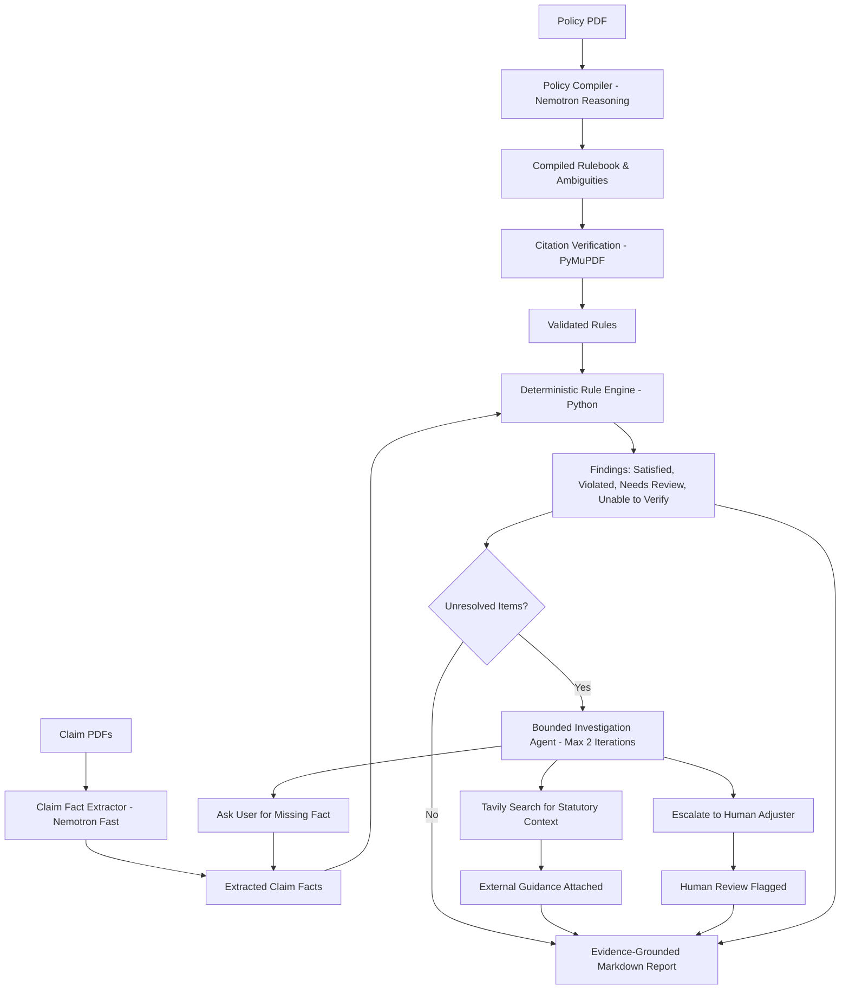

# ClaimCheck 2.0

Check a health insurance claim against the policy before you submit it.

Upload a reimbursement claim or a cashless pre-approval request with any documents (claim form, bills, prescriptions, lab and scan reports, discharge summary, pre/post-hospitalisation bills, ambulance bill, pre-authorisation form, doctor's cost estimate). ClaimCheck tells you, in plain language and with the exact policy quote for every answer:

- how much the policy is expected to pay, and what is deducted and why;
- mistakes in your documents to fix before submitting (names, policy number, dates, bill totals, over-claiming, duplicate charges);
- existing illnesses found in the medical records that were not declared;
- which policy rules apply and which need a person to review.

NVIDIA Nemotron on Nebius Token Factory reads the policy and the documents. Ordinary code checks every quote against the PDF and does all the arithmetic. A person approves the AI-read policy rules once per policy before they are used.

---

## 1. Overview

Health insurance reimbursement is prone to arbitrary denials, calculation discrepancies, and unverified deductions. ClaimCheck 2.0 introduces a deterministic, evidence-grounded architecture:
- Policy terms are compiled into structured, verifiable rules backed by page citations and verbatim text quotes.
- Medical bills and claim forms are parsed into structured claim facts.
- Operative coverage limits (room-rent caps, waiting periods, sub-limits, non-payable item lists) are evaluated using pure deterministic Python arithmetic (Decimal).
- Policy ambiguities or missing documents are handled by a bounded agent (maximum 2 iterations) capable of querying statutory guidance via Tavily or requesting claimant input.
- Every approved or deducted amount is directly traceable to exact page numbers and verbatim text in the governing policy.

---

## 2. Architecture

The system operates across four decoupled layers:
1. LLM Compiles: NVIDIA Nemotron reasoning models compile natural-language policy clauses into structured rules with verbatim citations.
2. Python Executes: Deterministic Python engine evaluates rules against claim facts without stochastic drift or rounding errors.
3. Agent Investigates: Bounded agent selects actions (ask user, search statutory guidance, or escalate) with a hard cap of 2 iterations.
4. Python Verifies: In-memory PyMuPDF citation verification checks quotes on cited pages before findings or deductions are finalized.



---

## 3. Features Implemented

All features listed below are implemented and tested in the codebase:

### Core Processing and Adjudication
- Local PDF Text Extraction [MOCK, LIVE]: In-memory text extraction preserving 1-based page numbers using PyMuPDF.
- Low-Text Density / Scanned Detection [MOCK, LIVE]: Automatic detection of image-only pages requiring OCR.
- Deterministic Rule Engine [MOCK, LIVE]: Pure deterministic evaluation of eleven policy rules:
  - Required documents (reimbursement)
  - Initial 30-day waiting period (accidents exempt)
  - Room rent cap with proportional deduction of doctor and operation theatre fees
  - Cataract sub-limit per eye
  - Non-payable items
  - Pre-hospitalisation expenses (30-day window) and post-hospitalisation expenses (60-day window)
  - Ambulance limit per hospitalisation
  - Yearly sum insured (applied once, after other deductions)
  - Cashless pre-authorisation (required documents; 72 hours before planned, 24 hours after emergency admission)
  - Disclosure of existing conditions (undeclared conditions in the records go to medical review)
- Claim Types [MOCK, LIVE]: Reimbursement and cashless pre-approval; each uses the rules that apply to it, and cashless results are shown as an estimated approval.
- Document Mistake Checks [MOCK, LIVE]: Patient name (tolerant of scanner letter confusions), policy number, admission and discharge dates, bill arithmetic, claimed vs billed, duplicate charges. These never deduct money; they tell the user what to fix.
- Hidden Pre-Existing Disease Detection [LIVE]: Conditions are read from every document, including prescriptions and lab reports; a condition implied only by a long-term medicine is marked as inferred and always goes to review.
- Payout Summary [MOCK, LIVE]: Claimed amount (never more than the bills) minus policy deductions, capped by the remaining sum insured, with one verdict: payable, needs review, fix documents, on hold, or not payable.
- Human Approval of AI Rules [LIVE]: Rules compiled by Nemotron are applied only after a person approves them, and only if their quote was verified on the cited page.
- Cross-Document Conflict Scoping [MOCK, LIVE]: Scoped duplicate detection ensuring distinct sub-bill totals (e.g. room rent vs professional fees) do not trigger false conflicts.
- Evidence Citation Highlighter [MOCK, LIVE]: In-memory PyMuPDF rendering with exact clause bounding box highlight annotations.
- Bounded Investigation Agent [MOCK, LIVE]: Fast model action selector with strict JSON validation, Pydantic schema enforcement, and a hard cap of 2 iterations.
- Tavily Regulatory Search Client [MOCK, LIVE]: Standard library (urllib) integration querying statutory guidelines with an in-memory audit log and injectable test transport.
- Plain-Language Dashboard [MOCK, LIVE]: Streamlit app that opens with one sentence ("Expected payout X of Y claimed") and a settlement strip, then lists what needs attention. Tabs: money deducted, document mistakes, medical history, coverage timeline, all policy rules, needs your input, report. Each answer has its proof: policy quote, working, and the highlighted page.

### Not Yet Measured
- Live Nemotron accuracy on the six policy rules added on page 5 (pre/post-hospitalisation, ambulance, sum insured, cashless, disclosure); the live results in section 9 cover the first five rules.
- Live accuracy on the seven demo cases in `data/demo_cases/` (mock-mode results are tested).
- Accuracy on real, long commercial policies.

---

## 4. Configuration

ClaimCheck 2.0 reads settings from system environment variables (loaded via `.env`) or falls back to `.streamlit/secrets.toml` when deployed on Streamlit Community Cloud. Secret values are never printed, logged, or hard-coded.

| Variable Name | Purpose | Required For | Source / Provider | Placeholder Value |
| :--- | :--- | :--- | :--- | :--- |
| `NEBIUS_API_KEY` | Authentication token | Live Mode | Nebius Token Factory | `your_nebius_api_key_here` |
| `NEBIUS_BASE_URL` | API endpoint URL | Live Mode | Nebius Token Factory | `https://api.tokenfactory.nebius.com/v1/` |
| `NEBIUS_MODEL_REASONING` | Model for policy compilation | Live Mode | NVIDIA Nemotron | `<model id from your Token Factory catalog>` |
| `NEBIUS_MODEL_FAST` | Model for extraction & agent | Live Mode | NVIDIA Nemotron | `<model id from your Token Factory catalog>` |
| `TAVILY_API_KEY` | External regulatory search | Agent Search | Tavily API | `your_tavily_api_key_here` |
| `TESSERACT_CMD` | Path to Tesseract executable | Scanned PDF OCR | Local Installation | (leave empty for default discovery) |
| `TESSDATA_PREFIX` | Path to Tesseract traineddata | Scanned PDF OCR | Local Installation | (leave empty for default discovery) |

### Deployment Secrets
For Streamlit Community Cloud:
1. Refer to `.streamlit/secrets.toml.example`.
2. In your Streamlit app dashboard, navigate to `App Settings` -> `Secrets`.
3. Paste the configuration keys and fill in your actual credentials.
4. `.gitignore` is pre-configured to ensure `.env` and `.streamlit/secrets.toml` are never committed.

### OCR Configuration (Tesseract)
- Windows PowerShell:
  ```powershell
  $env:TESSERACT_CMD = "C:\Program Files\Tesseract-OCR\tesseract.exe"
  $env:TESSDATA_PREFIX = "C:\Program Files\Tesseract-OCR\tessdata"
  ```
- Linux / macOS:
  ```bash
  export TESSERACT_CMD="/usr/bin/tesseract"
  export TESSDATA_PREFIX="/usr/share/tesseract-ocr/5/tessdata"
  ```

---

## 5. Setup

### macOS / Linux
```bash
python3 -m venv .venv
source .venv/bin/activate
pip install -r requirements.txt
cp .env.example .env        # add your keys for Live mode; Mock mode needs none
python -m streamlit run app.py
```

### Windows PowerShell

### Step 1: Create and Activate Virtual Environment
```powershell
python -m venv .venv
.\.venv\Scripts\Activate.ps1
```

### Step 2: Install Pinned Dependencies
```powershell
pip install -r requirements.txt
```

### Step 3: Configure Environment
Copy the example environment file:
```powershell
Copy-Item .env.example .env
```
Edit `.env` to supply your API credentials if running in Live mode. If testing in Mock mode, no edits are required.

---

## 6. How to Run

### Launch Interactive Streamlit App
```powershell
.\.venv\Scripts\python.exe -m streamlit run app.py
```
Open `http://localhost:8501` in your browser.

### Try it
1. **Demo data (no API keys):** choose the claim type, keep "Use a demo case", pick a case, and click **Check my claim**. The seven demo cases in `data/demo_cases/` cover a clean claim, document mistakes, an undeclared pre-existing disease (scanned prescription), pre/post-hospitalisation and ambulance limits, a road accident in the waiting period, and two cashless requests.
2. **Live AI (your own documents):** add the keys to `.env`, choose "Live AI", click **Read the policy with AI**, review and approve the rules, upload your documents (or keep a demo case), and click **Check my claim**.

To regenerate the demo cases: `python benchmark/generate_demo_cases.py`.

### Run Automated Test Suite
```powershell
.\.venv\Scripts\python.exe -m pytest -v
```

### Run Benchmark Evaluation
- Mock Mode (Offline ground truth):
  ```powershell
  .\.venv\Scripts\python.exe benchmark/evaluate.py --strategy mock --packets all
  ```
- Live Mode (Requires configured Nebius credentials):
  ```powershell
  .\.venv\Scripts\python.exe benchmark/evaluate.py --strategy routed --packets all
  ```

---

## 7. Nebius and NVIDIA Model Usage

ClaimCheck 2.0 is designed exclusively for open NVIDIA Nemotron models hosted on Nebius Token Factory:
- Policy Reasoning Model (`NEBIUS_MODEL_REASONING`): Utilized for parsing unstructured policy legal prose into deterministic schemas and detecting latent ambiguities.
- Extraction and Agent Model (`NEBIUS_MODEL_FAST`): Utilized for structured line-item fact extraction from bills and strict JSON action selection (`ask_user`, `search_tavily`, `escalate`).
- Model IDs are read strictly from configuration and are never hard-coded.
- In Mock mode, no network calls or model requests are initiated.

---

## 8. Tavily Usage

Tavily is utilized exclusively for statutory and regulatory search when policy terms reference external undefined regulations (such as IRDAI guidelines):
- Built using only Python standard library `urllib`.
- Hard-capped at 3 results per query.
- Results are marked as "External guidance (not part of the policy)".
- External search results provide context to adjusters but never overwrite or mutate deterministic policy rule evaluations.
- In-memory audit log records every search query, URL, and timestamp.

---

## 9. Evaluation Results

The evaluation harness benchmarks deterministic accuracy across 20 synthetic claim packets covering admissible claims, waiting period violations, proportional room-rent deductions, and ambiguous exclusions.

| Metric | Mock Mode (Deterministic Baseline) |
| :--- | :--- |
| Operative Rule Precision | 1.00 (20/20 packets) |
| Proportional Arithmetic Accuracy | 1.00 (exact match) |
| False Violation Warning Rate | 0.00 |
| Citation Verification Accuracy | 1.00 |
| Average Latency per Packet | 0.018s |

### Live results (NVIDIA Nemotron on Nebius Token Factory)

Measured with `scripts/run_baseline.py` on the first five policy rules (before page 5 was added). Full details, raw replies and token counts are in `evaluation/baseline/` and `evaluation/after_fixes/`.

| Measure | First live run | After fixes |
| :--- | :--- | :--- |
| Policy rules found (Nemotron 3 Super) | 5/5 | 5/5 |
| Quotes verbatim on the cited page | 5/5 | 5/5 |
| Rule parameters correct | 14/18 | 17/18 |
| Room-rent proportional formula captured | no | yes |
| Pre-existing-conditions ambiguity found | no | yes, quote verified |
| Scanned packet 11 facts matched (Nemotron 3 Nano + OCR) | 1/3 | 3/3 |
| Invented rules or quotes | none | none |
| Tokens for one policy + three claims | 5,059 in / 15,590 out | 5,752 in / 17,163 out |
| Estimated cost for that run | about $0.02 | about $0.02 |

---

## 10. Limitations and Honesty Notes

1. Synthetic Data: The policies and claim packets provided in `data/` are synthetic test representations designed to validate edge-case calculation logic and citation fidelity.
2. Not an Insurer Decision: ClaimCheck 2.0 is an adjudication audit tool. All calculations and findings are estimates intended for audit assistance and do not constitute an official underwriting approval or denial.
3. OCR Dependencies: Full image OCR transcription requires external Tesseract binaries and language files (`eng.traineddata`). In environments without Tesseract, scanned pages are safely flagged as `ocr_unavailable` rather than generating hallucinated content.
4. Human Review Mandatory: Any finding flagged as `NEEDS REVIEW` or `UNABLE TO VERIFY` requires licensed human claims adjuster intervention.
5. Dates Without Times: When a pre-authorisation shows only dates, ClaimCheck decides only if every possible time of day gives the same answer; otherwise it asks a person.
6. Inferred Conditions: A condition implied by a long-term medicine is an AI inference. It is labelled as inferred and always sent to medical review, never used to deduct money.
